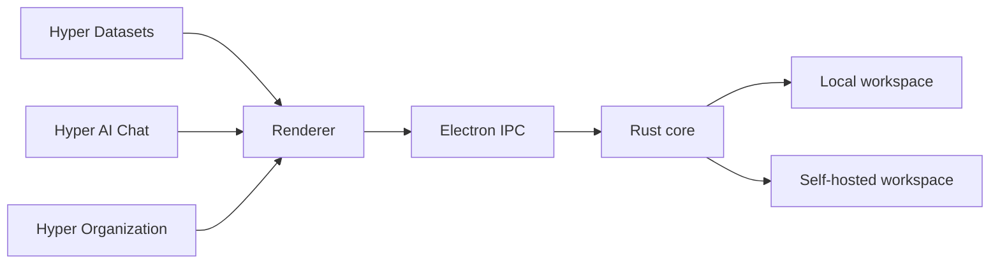
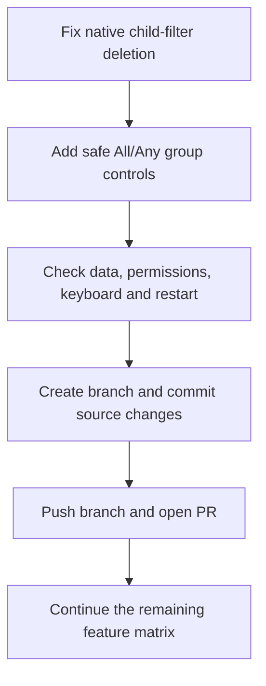

# HyperTask feature roadmap

Full feature parity with the [comparison document](AppFlowy_vs_AFFiNE_Features_and_Implementation.md) is not complete. The [feature record](../frontend/appflowy_electron/docs/FEATURE_PARITY.md) lists verified work and open gaps.

## Current state

Hyper Datasets has grid, board, calendar and row-page support. Hyper AI Chat has streaming, selected context, automatic endpoint model discovery and a saved default model. Hyper Organization has all-docs views, tags, collections and journals. These areas are partly implemented and tested. They do not yet cover every upstream feature.

The final PR checkpoint passed 1,627 tests in 265 files without skips. It includes inline equations, Markdown formatting, saved calendar week starts, exact minute-based Time filters and native filter groups. All three TypeScript checks and a fresh production build pass. The corrected core also passes 71 focused native cases and all 102 database library tests, counted separately. The watched Electron app is running.

## Delivery order

1. Completed: finish the active filter-group work. Use the public insertion operation that keeps the old criterion. Change All/Any in a separate saved action. Prove that removal changes saved data.
2. Completed: check the affected native and renderer paths. Preserve workspace data, credentials, the theme and upstream compatibility. Keep the watched Electron app available.
3. Delivery: commit all current source changes on a new branch, push the branch and open a PR. Exclude runtime caches and private workspace data.
4. Add editable Time cells and Time-property creation. Distinguish an empty value from zero before allowing edits. Keep the existing data format compatible.
5. Complete the remaining database filter, sort, group, calculation and card-setting flows.
6. Complete sharing, live cursors, offline merges and broader multi-client checks.
7. Complete diagrams, other document/export formats, remaining AI tools and real-provider checks.
8. Address the remaining mobile, administration and deployment work.

This order has no promised dates. Each step needs implementation and evidence before it is marked complete. The PR for this checkpoint will list the remaining gaps.
